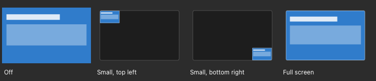

<p align="center">
  
</p>

<h1 align="center">Flick</h1>

<p align="center">A macOS window switcher with previews.</p>

## Build and run

Requires macOS 14+ and Swift 5.9+. Install Xcode Command Line Tools with `xcode-select --install` if needed.

From the repository folder:

```sh
./build.sh
open Flick.app
```

Move `Flick.app` to Applications to keep it installed. **Open at Login** is available in Flick’s menu.

## Setup

Grant **Accessibility** permission for shortcuts and window switching, and **Screen Recording** for previews. Without screen access, Flick shows app icons. Reopen Flick if macOS requests it.

Quit other apps using Option + Tab to avoid shortcut conflicts.

## Controls

| Action | Control |
| --- | --- |
| Cycle through windows | Hold **Option**, press **Tab** |
| Cycle backward | Add **Shift** |
| Cycle within the current app | Hold **Option**, press **backtick** (`) |
| Change selection | **Left / Right arrows**, scroll, or hover a card |
| Switch to selection | Release **Option**, press **Return**, or click |
| Cancel | **Escape** or click outside |

Flick lists on-screen windows on the current desktop, excluding minimized windows and hidden apps.

## Window size and position

Enable **Show Window Size & Position** in Flick’s menu to show each window’s relative size and location on its display. Otherwise, the image fills the preview card.



*Rendered examples using sample window content.*

## Build a release DMG

With Xcode installed, save your notarization credentials in Keychain once using
`xcrun notarytool store-credentials DeveloperID-Notary`. Then run:

```sh
./Scripts/release.sh
```

The script builds for Apple silicon and Intel, signs with Developer ID, submits
the disk image to Apple, and staples and verifies the ticket. Upload the DMG
printed at the end to GitHub Releases. If you have multiple Developer ID
Application certificates, set `SIGNING_IDENTITY` to the certificate name.
Set `NOTARY_PROFILE` to use a different Keychain profile.

### Publish from GitHub Actions

Create a GitHub Actions environment named `release` and add these secrets:

| Secret | Value |
| --- | --- |
| `CERTIFICATE_P12_BASE64` | Base64 of the password-protected Developer ID Application certificate and private key exported together as a .p12 from Keychain Access |
| `CERTIFICATE_PASSWORD` | Password used for that export |
| `NOTARY_PRIVATE_KEY` | Full text of the App Store Connect team API key (.p8), including its header, footer, and line breaks |
| `NOTARY_KEY_ID` | Key ID shown for that key |
| `NOTARY_ISSUER_ID` | Issuer ID from the Team Keys page |

On macOS, `base64 -i /path/to/signing.p12 | pbcopy` copies the encoded certificate
for the secret. Store both private key files outside the checkout. Restrict who can
push release tags or access the release environment.

Push a tag matching the version in `Info.plist` (for example, `v1.0` for version
`1.0`). The workflow runs the tests, signs and notarizes the universal DMG, and
publishes a GitHub Release with the verified disk image attached.

## Support

[Buy me a coffee](https://buymeacoffee.com/boleg)
